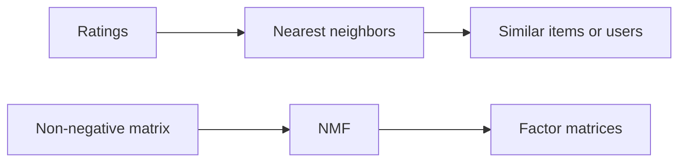

# Recommendation systems study

A 2023 collection of Python experiments exploring how to generate recommendations from ratings and text. The scripts are independent exercises with different inputs.

## Architecture



## What to explore

- `collabrative-filtering.py` fits nearest-neighbor models and exposes item and user recommendation examples.
- `hybrid-model.py` reads movie and rating CSV files from the local Kaggle input directory. Supply those files to run this exercise.
- `nmf.py` factors a fixed 3-by-3 matrix into two non-negative factors with two components. It runs without external data.
- `tf-idf.py` explores text features. `stock-data.py` is a separate time-series experiment.

## Run locally

Use a Python virtual environment. For the self-contained matrix example:

```sh
python -m pip install numpy scikit-learn
python nmf.py
```

## Decisions and limitations

Nearest neighbors uses observed similarity directly. Factorization compresses the matrix into a chosen number of components. The small matrix makes the transformation easy to inspect. It gives no estimate of recommendation quality on new users. There is no automated test suite or published held-out accuracy benchmark.